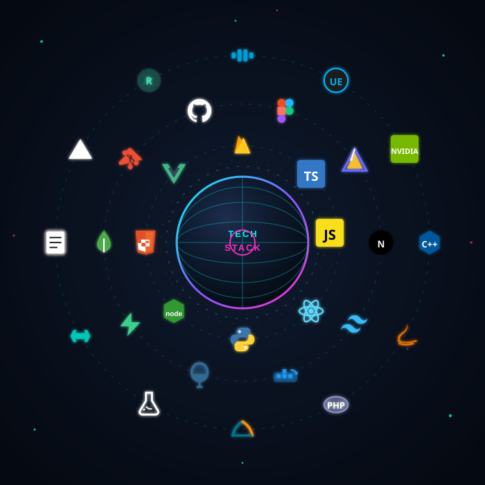

**Building useful experiences, from the interface to the database.**

[Email](mailto:moralesmickdaniel7@gmail.com) · [LinkedIn](https://www.linkedin.com/in/danielmrlss/) · [Instagram](https://instagram.com/danielmrlss) · [Facebook](https://www.facebook.com/Dnlmrlss)

## Hey, I'm Daniel

I'm **Mick Daniel Morales**, a full-stack developer interested in web and mobile applications, practical backend systems, and UI/UX design. I enjoy connecting a clear interface with the logic and data that make it useful.

- **Building:** Tag-Abantay, Minnies Farm Resort, and Fiesta Finder.
- **Learning:** Next.js, Supabase, and serverless Flask.
- **Exploring:** network architecture and backend performance.
- **Open to:** collaboration on full-stack web and mobile projects.
- **Away from the keyboard:** long bike rides to clear my head.

[Explore my repositories →](https://github.com/Mick24-sv?tab=repositories)

## Tools I work with

| Area | Technologies |
| :--- | :--- |
| **Web & mobile** | React · React Native · Next.js · Vue · Vite · Tailwind CSS · HTML |
| **Backend** | Node.js · Flask · PHP · Supabase · Firebase |
| **Databases** | PostgreSQL · MySQL · MongoDB · SQLite |
| **Languages** | JavaScript · Python · Java · C++ · PHP · R |
| **Shipping & design** | Git · Docker · Vercel · Netlify · Render · Figma |

View my animated tech stack

  

## Contribution snake

<picture>
  <source media="(prefers-color-scheme: dark)" srcset="https://raw.githubusercontent.com/Mick24-sv/Mick24-sv/output/github-contribution-grid-snake-dark.svg" />
  <source media="(prefers-color-scheme: light)" srcset="https://raw.githubusercontent.com/Mick24-sv/Mick24-sv/output/github-contribution-grid-snake.svg" />
  
</picture>

---

**Have an idea worth building? [Let's talk.](mailto:moralesmickdaniel7@gmail.com)**

